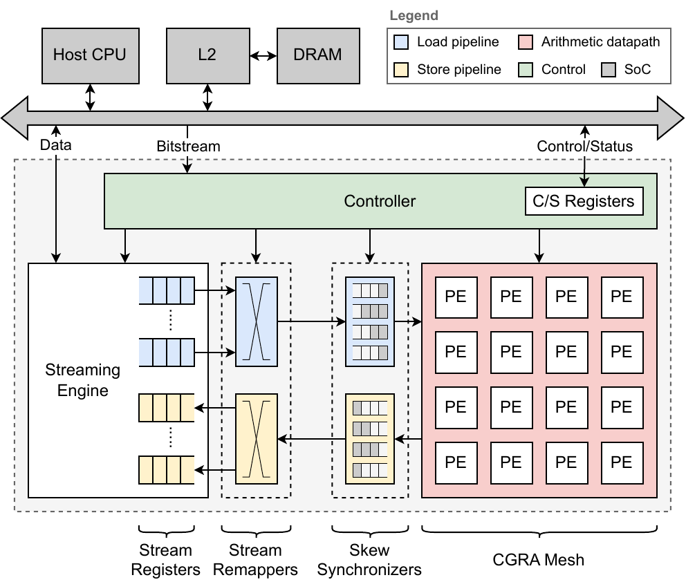
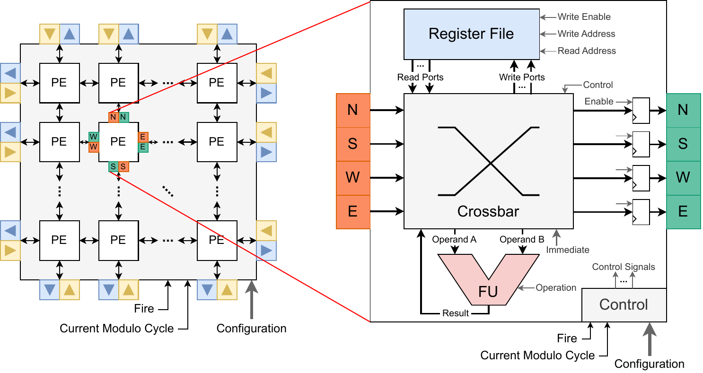
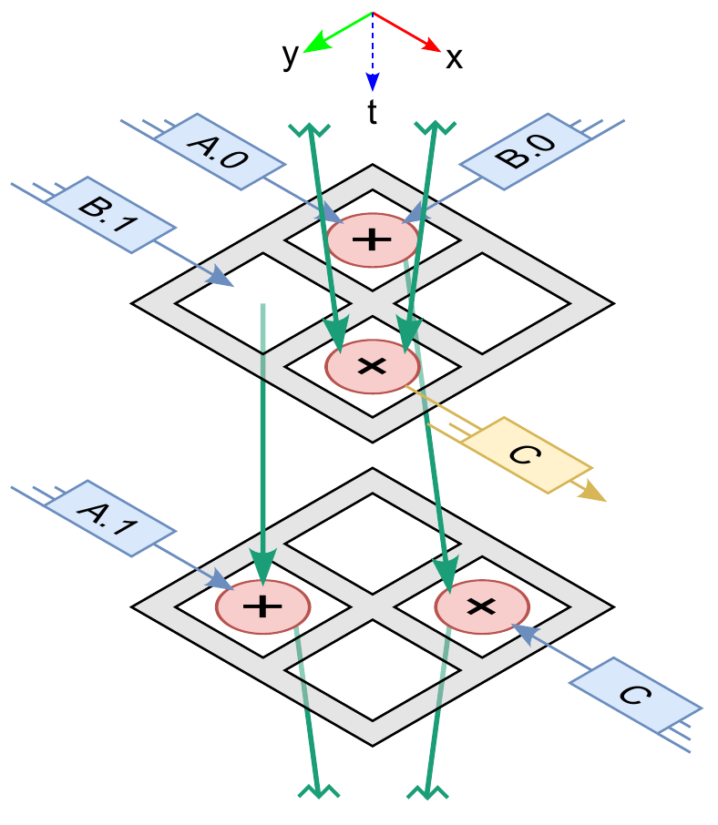
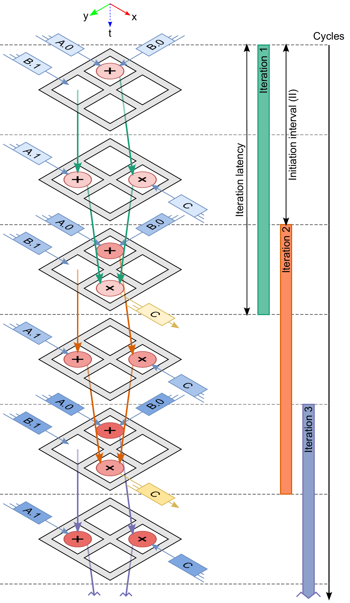
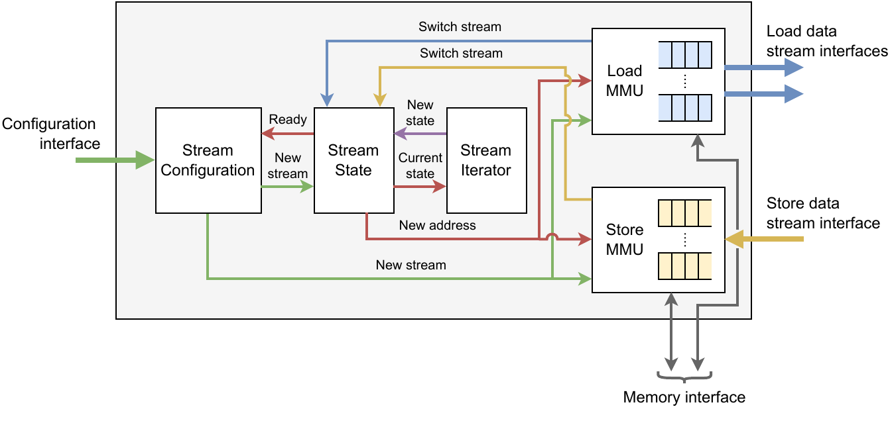
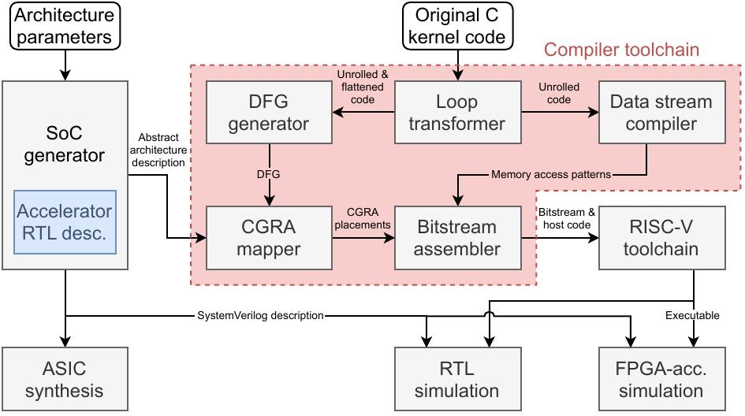

# BubbleTea

**A stream-driven CGRA accelerator for RISC-V SoCs, written in Chisel.**

BubbleTea is a coarse-grained reconfigurable array (CGRA) whose processing elements only compute. All memory access is moved to a dedicated **streaming engine** that implements the stream model of the RISC-V Unlimited Vector Extension (UVE). Kernels are described as loop nests. The compiler turns each one into a set of data-stream descriptors (what to load and store) and a dataflow graph (what to compute). The streaming engine walks the descriptors and feeds the array, and the array executes the graph on a modulo schedule.

The accelerator plugs into a [Chipyard](https://github.com/ucb-bar/chipyard) Rocket Chip SoC as a memory-mapped peripheral that shares the system bus and L2 with the host core.

This is the hardware from my MSc thesis at Instituto Superior Técnico / INESC-ID and from the accompanying paper:

> J. Maia, **"Stream-based Coarse-Grained Reconfigurable Accelerator"**, MSc thesis, Instituto Superior Técnico, 2025. Supervised by P. Tomás and N. Roma. [[Record]](https://scholar.tecnico.ulisboa.pt/records/q6Wju__CshOqaxesH3UP-CUDHal3EJJy20WS) [[PDF]](https://scholar.tecnico.ulisboa.pt/api/records/q6Wju__CshOqaxesH3UP-CUDHal3EJJy20WS/file/14a4768311b9258c6883ac82405e130e8df23b1b5560c0ca9e6b9eb3461c8d2e.pdf)
>
> J. Maia, A. Silveira, G. Midões, N. Neves, P. Tomás, N. Roma, **"Stream-Driven Acceleration for Embedded RISC-V SoCs"**, IEEE ISCAS 2025. [[IEEE Xplore]](https://ieeexplore.ieee.org/document/11043244/)

## Architecture



The accelerator has four parts:

- **Streaming engine:** decodes UVE-style stream descriptors (multi-dimensional affine access patterns) and generates addresses. It fetches whole cache lines, reorders out-of-order responses and assembles stream vectors in the load stream registers. Store streams flow back the same way.
- **Stream remappers:** permutation networks (Beneš) that scatter each stream vector into the per-port *micro-streams* the array expects, and gather results back into store streams.
- **Skew synchronizers:** delay lines that line up micro-streams, which arrive at different array ports at different cycles of the schedule.
- **CGRA mesh:** a 2-D grid of processing elements, fed at its edges.
- **Controller:** holds the configuration, loads new bitstreams while the current kernel runs, and exposes control/status registers to the host.

### Processing elements



Each PE has a floating-point functional unit, a small register file and a crossbar to its four neighbours. Its behaviour in each cycle of the modulo schedule comes from its configuration word. The mesh size, data type, register file size and ports, and maximum initiation interval are all generator parameters. The reference configuration is a 4×4 FP32 mesh.

### Execution model

<table>
  <tr>
    <td align="center" valign="top" width="50%"><br><sub>Mapping: each operation gets a PE and a cycle within one II</sub></td>
    <td align="center" valign="top" width="50%"><br><sub>Execution: a new iteration starts every II cycles, overlapping the previous ones</sub></td>
  </tr>
</table>

The loop body is unrolled into a dataflow graph and mapped onto the mesh in space and time: each operation is assigned a PE and a cycle within a repeating schedule of length II (the initiation interval). Values move between operations over PE-to-PE links or wait in registers. In steady state, a new loop iteration starts every II cycles, so several iterations are in flight at once (right), while the streaming engine keeps the operands coming.

### Streaming engine



## Toolchain and system



Kernels are compiled with **[StreamFlow](https://github.com/joaofbmaia/streamflow)**. It takes an annotated C loop nest and produces the bitstream and host code. The integration into Chipyard (configs, software and simulation flow) lives in **[chipyard-bubbletea](https://github.com/joaofbmaia/chipyard-bubbletea)**.

## Repository layout

| Path | Contents |
|---|---|
| `src/main/scala/bubbletea/` | Accelerator RTL: mesh, PEs, remappers, delay lines, controller, Chipyard periphery |
| `src/main/scala/streamingengine/` | Streaming engine (Chisel) |
| `src/main/resources/streamingenginesv/` | Streaming engine (SystemVerilog version, used as a black box) |
| `src/main/scala/bitstreamassembler/` | Bitstream assembler: turns mapper output and stream descriptors into a configuration bitstream |

## Building

BubbleTea is built as part of Chipyard, using the [chipyard-bubbletea](https://github.com/joaofbmaia/chipyard-bubbletea) fork, `bubbletea` branch:

```bash
cd sims/verilator
make CONFIG=Bubbletea4x4x8Fp32Config
```

`Bubbletea4x4x8Fp32Config` is a Rocket SoC with a 4×4 FP32 BubbleTea and a maximum II of 8. `Bubbletea4x4x16Fp32Config` raises the maximum II to 16.

The generator is built through Chipyard's `build.sbt`; this repository is not a standalone sbt project.
